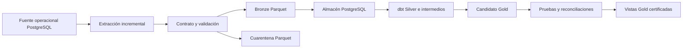

# Plataforma de Datos para E-commerce

Plataforma local de ingeniería de datos que transforma cambios de un sistema operacional
de comercio electrónico en productos analíticos confiables.

El proyecto ingiere pedidos, ítems, pagos, productos, vendedores y clientes desde
PostgreSQL; conserva evidencia original en Parquet; valida contratos y filas inválidas;
modela métricas con dbt; y publica vistas Gold certificadas para análisis de
cumplimiento, comercio y categorías.

## Productos analíticos

| Producto | Grano | Uso principal |
|---|---|---|
| `mart_daily_order_fulfillment` | Una fila por fecha de compra | Cumplimiento y entregas tardías |
| `mart_daily_commerce` | Una fila por fecha de compra | GMV, flete, AOV y CLP |
| `mart_daily_category_commerce` | Fecha y categoría | Desglose del GMV por producto |
| `mart_daily_refunds` | Una fila por fecha de devolución | Eventos sintéticos de devolución |

`gmv_brl` se calcula sobre ítems de pedidos elegibles, sin flete y sin descontar devoluciones;
no representa ingreso contable.
Las devoluciones son sintéticas porque Olist no contiene eventos observados de devolución.
`gmv_clp` es una conversión aditiva y actualmente es la única métrica CLP certificada.
Las definiciones completas están en el [glosario de métricas](docs/metrics.md).

## Cómo funciona



Cada entidad usa una ventana incremental acotada por cursor. La extracción fija su
límite superior dentro de un snapshot estable y registra un lote comprometido antes
de avanzar el punto de control.

## Capas de datos

- **Bronze:** evidencia de lo recibido, con manifest y hashes.
- **Silver:** versiones normalizadas y selección del estado actual por clave.
- **Gold:** productos de consumo con grano, métricas y pruebas explícitas.

Una publicación Gold se construye primero como candidato. Solo una ejecución dbt
exitosa y validada puede reemplazar la vista estable. Un fallo de transformación no
debe reemplazar la última publicación certificada.

## Ejecución rápida

La ruta más corta usa fixtures sintéticos, no requiere descargar Olist, no consulta
proveedores FX y no inicia Airflow:

```bash
cp -n .env.example .env
uv sync --frozen --extra dev
scripts/demo_synthetic.sh
```

La demo:

- Levanta los dos PostgreSQL locales.
- Ingresa las siete entidades.
- Ejecuta extracción incremental y carga idempotente.
- Genera una devolución sintética.
- Usa tasas de cambio sintéticas para BRL/CLP.
- Ejecuta `dbt seed` y `dbt build`.
- Publica los cuatro productos Gold.

El script utiliza `var/demo-data/`, ignorado por Git, y no elimina volúmenes Docker.
Para empezar desde cero, usa un proyecto Compose nuevo o reinicia los volúmenes de forma
explícita. El `publication_id` se imprime al finalizar.

Los resultados quedan disponibles en las vistas `gold.*` del almacén.

## Arquitectura de datos

### Ingesta y recuperación

- Carga inicial determinista con suma de comprobación para el dataset Olist.
- Extracción incremental por `(source_updated_at, key)`.
- Paginación con ventana superior fija.
- Reprocesamientos acotados que no avanzan el punto de control normal.
- Reintentos seguros e idempotencia por lote.

### Calidad de datos

- Contratos explícitos para entradas operacionales y productos Gold.
- Filas inválidas aisladas en cuarentena cuando es seguro continuar.
- Cambios estructurales incompatibles fallan cerrados.
- Comprobaciones de huérfanos, reconciliaciones, grano y métricas.
- Tipos monetarios de precisión fija y política temporal documentada.

### Publicación analítica

- Candidatos Gold con identificador de publicación.
- Artefactos `manifest.json` y `run_results.json` asociados a la misma invocación dbt.
- Bloqueo transaccional por producto y por punto de control.
- Vistas Gold estables independientes de las tablas candidatas.
- Retención segura de candidatos antiguos y fallidos.

## Stack

| Componente | Responsabilidad |
|---|---|
| PostgreSQL | Fuente operacional y almacén analítico local |
| Python | Bootstrap, extracción, carga y comandos operativos |
| Parquet | Evidencia Bronze y cuarentena |
| dbt | Modelos Silver, intermedios, Gold y pruebas |
| Airflow | Orquestación opcional de los comandos existentes |

## Empezar

El dataset histórico de Olist no está incluido en Git. Está sujeto a sus propios términos
CC BY-NC-SA 4.0 y debe ubicarse en `dataset/` respetando los nombres originales.

Para el flujo completo se necesita Docker Desktop, Python 3.12, `uv` y un `.env` local:

```bash
cp -n .env.example .env
uv sync --frozen --extra dev
docker compose up -d --wait source-postgres warehouse-postgres
```

El procedimiento detallado para la carga inicial, el lector, la extracción, dbt y la
publicación está en la [guía operativa](docs/phase1-implementation-guide.md).

Airflow es opcional y se activa separadamente:

```bash
docker compose --profile airflow up -d airflow
```

El DAG `ecom_pipeline` se ejecuta manualmente. Su configuración está en
[Airflow](dags/ecom_pipeline.py) y la
decisión arquitectónica en [ADR-009](docs/adrs/ADR-009-airflow-orchestration.md).

## Verificaciones

La integración continua ejecuta análisis estático, pruebas unitarias y un ciclo sintético
completo con dos PostgreSQL efímeros. La verificación local de cierre V1 incluyó:

- 25 pruebas unitarias aprobadas.
- 49 pruebas de integración aprobadas.
- Reconciliación final aprobada.
- dbt en las etapas base y final con `67/67` nodos exitosos.
- Publicación de los cuatro productos Gold en ambas etapas.
- Demo sintética completa con fixtures y sin red externa.

Resultados obtenidos con fixtures sintéticos; no corresponden a una ejecución completa del
dataset Olist.

## Limitaciones

La versión actual no incluye:

- Dashboard o API pública.
- CDC, streaming o captura de hard deletes.
- Infraestructura en la nube o alta disponibilidad.
- Métricas de clientes nuevos/recurrentes.
- Métricas Gold por vendedor.
- GMV neto de devoluciones.
- CLP para columnas y productos todavía no certificados.

El estado actual, invariantes y próximas etapas están registrados en
[`docs/CURRENT_STATE.md`](docs/CURRENT_STATE.md).

## Documentación

- [Estado actual](docs/CURRENT_STATE.md): alcance, evidencia y pendientes.
- [Glosario de métricas](docs/metrics.md): grano y definiciones de negocio.
- [SDD](SDD.md): diseño técnico aceptado.
- [ADR-002](docs/adrs/ADR-002-incremental-commit-protocol.md): cursor, lote, punto de control y recuperación.
- [ADR-003](docs/adrs/ADR-003-contract-quality-quarantine.md): contratos y cuarentena.
- [ADR-004](docs/adrs/ADR-004-fulfillment-mart.md): Gold y promoción certificada.
- [ADR-005](docs/adrs/ADR-005-commerce-metrics.md): GMV, AOV, flete y devoluciones.
- [Pruebas](docs/testing/phase1-test-matrix.md): cobertura y casos de fallo.
- [Evidencia histórica](docs/evidence/): cierres de fases anteriores.

## Licencia y fuentes

El código se distribuye bajo [MIT](LICENSE). El dataset Olist conserva sus propios
términos y no se incluye en este repositorio. Las credenciales y configuraciones locales
se mantienen fuera de Git.
